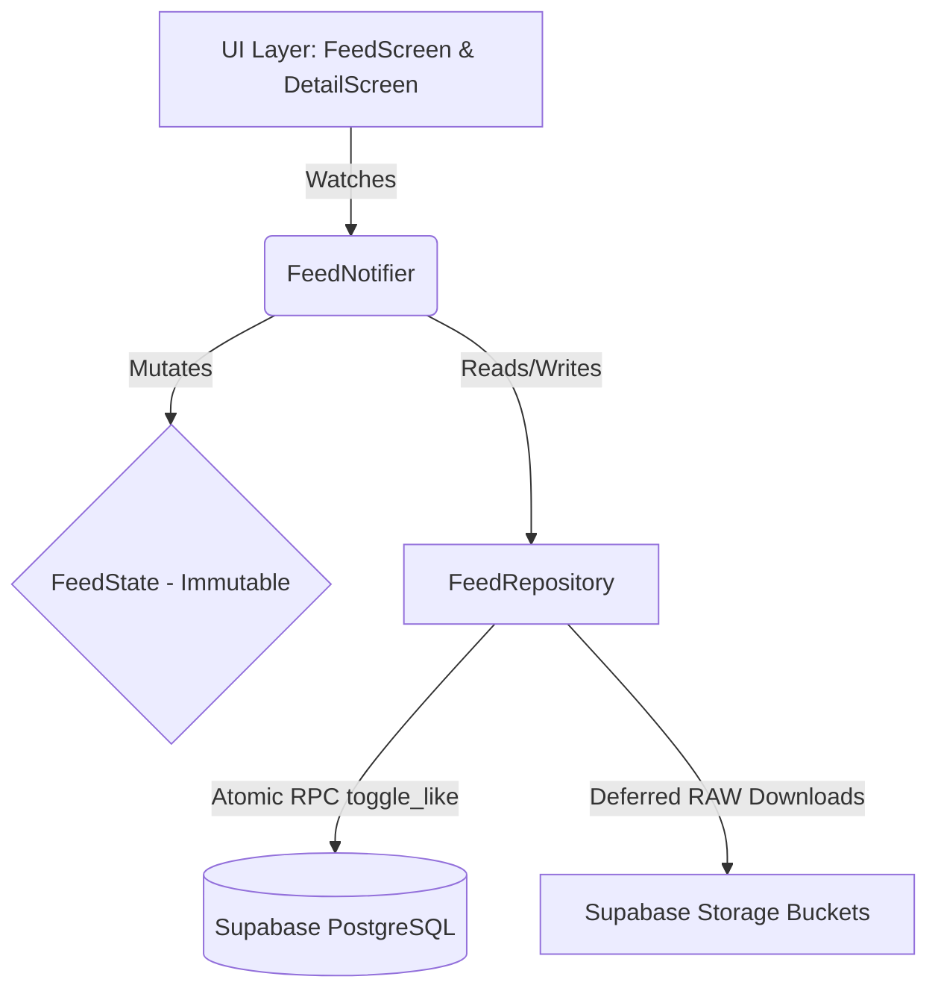

# 📱 High-Performance Social Feed

[](https://flutter.dev)
[](https://riverpod.dev)
[](https://supabase.com)
[](https://pub.dev/packages/dio)
[](https://opensource.org/licenses/MIT)

A production-grade, 60fps Flutter mobile social feed engineered with heavy emphasis on client-side rendering performance, RAM memory efficiency, GPU cache boundaries, and zero-latency optimistic state synchronization.

---

## 🚀 Engineering Highlights & Optimizations

* **GPU Rasterization Optimization (`RepaintBoundary`)**: Isolates complex feed post card widgets containing dynamic shadows and border radii. Prevents the Flutter rendering engine from re-rasterizing the entire viewport during high-velocity fling scrolling.
* **Strict RAM Decoding (`memCacheWidth`)**: Automatically calculates image memory constraints based on physical device pixel ratio (`devicePixelRatio`). High-resolution network assets are downsampled at image decoding time, avoiding memory bloat and OOM crashes.
* **Tiered Multi-Resolution Asset Loading**:
  * **Ultra-Light Thumbnails**: Instantly loaded on the main feed list to minimize initial bandwidth.
  * **Medium-Resolution**: Lazy-loaded when viewing the single-post details view.
  * **Deferred RAW Downloads**: Full uncompressed RAW image binaries are downloaded only upon explicit user request using `Dio`.
* **Zero-Latency Optimistic State Mutation**: Instant UI updates (like count, heart state) using Riverpod unidirectional state flow. Actions are applied with 0ms perceived delay and synchronized to Supabase in the background.
* **Debounced Network Synchronization**: Eliminates rapid double-tap spam through an internal timer debouncer, coalescing rapid toggles into a single atomic RPC call.
* **Automatic Rollback**: Restores original state transparently if a network failure or database timeout occurs.

---

## 🏛️ System Architecture



---

## 🛠️ Tech Stack & Dependencies

* **Framework**: Flutter & Dart (Null-Safe)
* **State Management**: `flutter_riverpod` (`NotifierProvider`, `AsyncValue`)
* **Backend & DB**: `supabase_flutter` (PostgreSQL with Row-Level Security, Database Functions)
* **Image Management**: `cached_network_image` with dynamic cache limits
* **Network & File Transfer**: `dio` (Chunked on-demand raw downloads)
* **UI Components**: `flutter_spinkit`, `google_fonts`, `hero` animations

---

## 📂 Project Structure

```
flutter_high_performance_feed/
├── lib/
│   ├── config/              # App themes, constants, and API endpoints
│   ├── models/              # Immutable post models & serialization
│   │   ├── feed_state.dart  # Immutable state with copyWith
│   │   └── post_model.dart  # Post schema matching Supabase
│   ├── providers/           # Riverpod state notifiers & debounce controllers
│   │   └── feed_provider.dart
│   ├── repositories/        # Data access layer for Supabase queries & RPCs
│   │   └── feed_repository.dart
│   ├── screens/             # Presentation layer
│   │   ├── feed_screen.dart # 60fps infinite scrolling ListView
│   │   └── detail_screen.dart # High-res view with Hero animations
│   ├── widgets/             # Reusable RepaintBoundary-wrapped cards
│   │   └── post_card.dart
│   └── main.dart            # Supabase initialization & App bootstrap
├── assets/                  # Seed demo post images
├── seed_demo_posts.py       # Python automated database seeding script
├── update_likes.sql         # Supabase PostgreSQL atomic RPC definition
└── pubspec.yaml             # Flutter dependencies
```

---

## ⚡ Setup & Installation

### 1. Prerequisites
* Flutter SDK (3.10+)
* Dart SDK (3.0+)
* A Supabase project account ([supabase.com](https://supabase.com))

### 2. Database & SQL Setup
Execute the following RPC function in your Supabase SQL Editor:

```sql
create or replace function toggle_like(post_id uuid, user_id uuid, should_like boolean)
returns void as $$
begin
  if should_like then
    update posts set likes_count = likes_count + 1 where id = post_id;
  else
    update posts set likes_count = greatest(0, likes_count - 1) where id = post_id;
  end if;
end;
$$ language plpgsql security definer;
```

### 3. Configure Credentials
Add your Supabase URL and Anon Key in `.env` or `lib/config/constants.dart`:
```dart
const String supabaseUrl = 'YOUR_SUPABASE_PROJECT_URL';
const String supabaseAnonKey = 'YOUR_SUPABASE_ANON_KEY';
```

### 4. Run Application
```bash
# Get dependencies
flutter pub get

# Run on emulator or physical phone
flutter run
```

---

## 🧪 Seeding & Test Suite

To seed sample demo posts with multi-tier image URLs into your database:
```bash
python seed_demo_posts.py
```

Run unit and widget tests:
```bash
flutter test
```

---

## 📄 License

This repository is licensed under the [MIT License](LICENSE).
